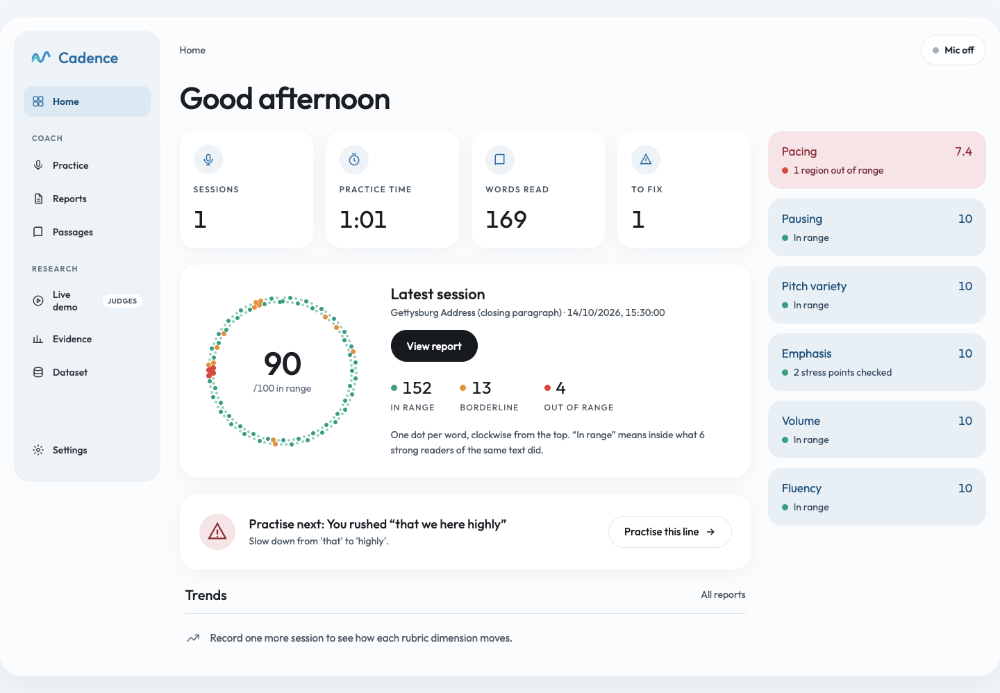
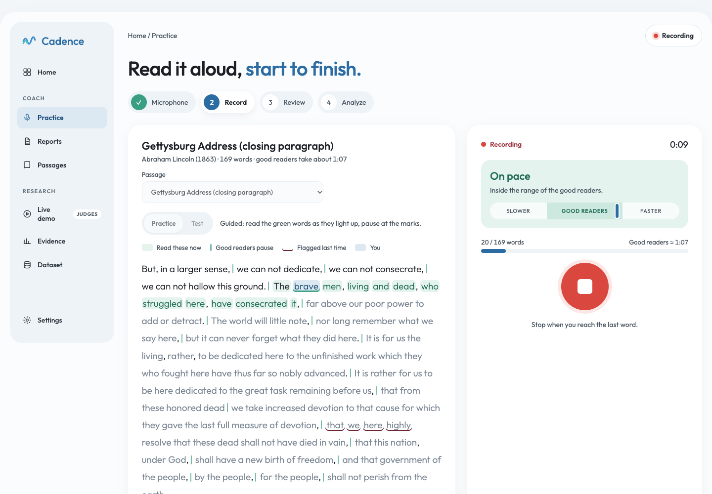
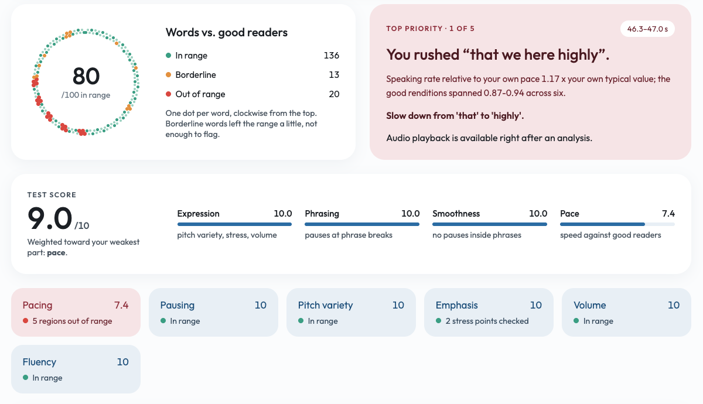
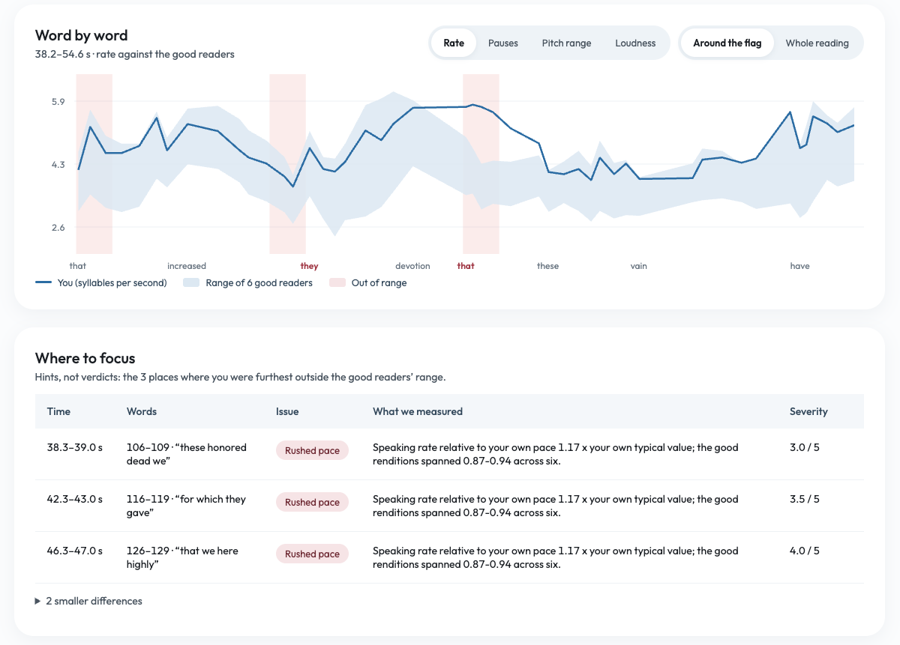
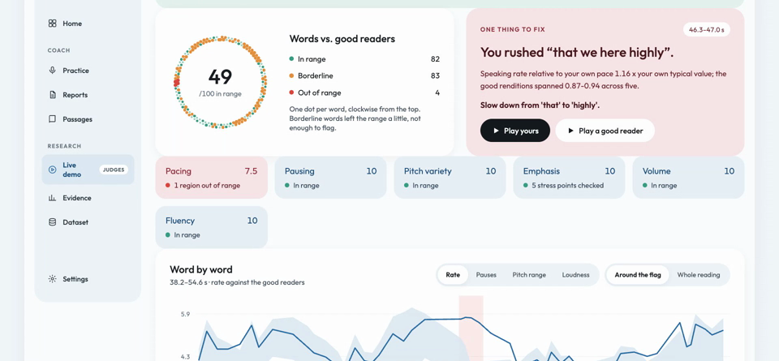
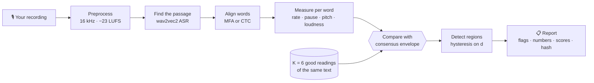
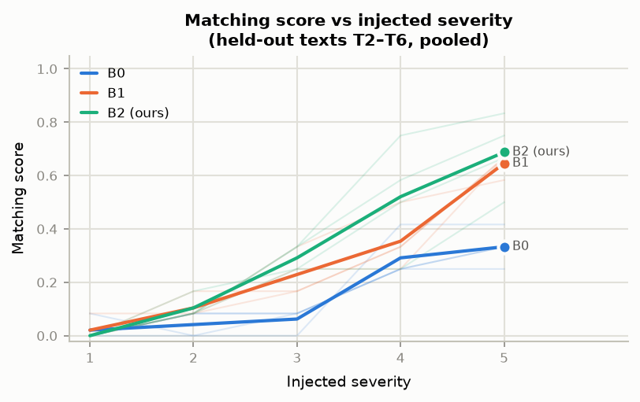
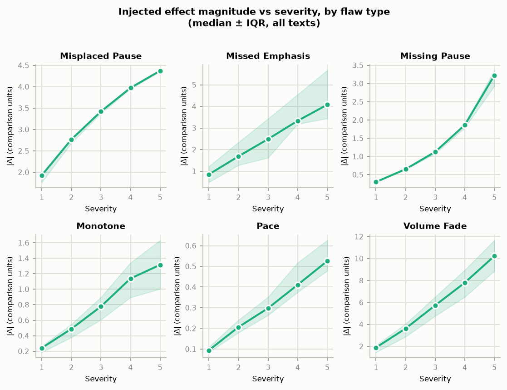
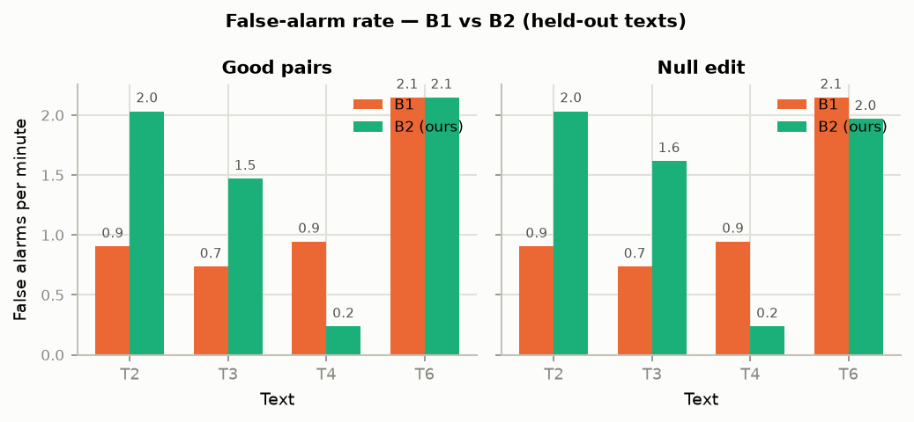
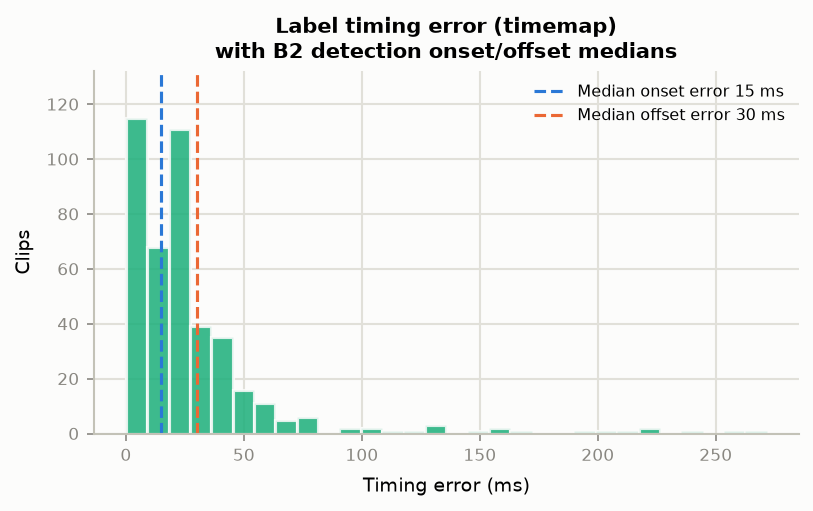

<div align="center">

# 〰️ Cadence

### Your delivery, judged against *every* great reading of the same words — not one, not a rulebook.

**Contrastive speech analytics · Track C**

[](https://github.com/kanakamurthyh/Cadence/actions/workflows/rerun.yml)


[](https://huggingface.co/datasets/Vedant1605/cadence-contrastive-speech)



[**Quick start**](#quick-start-5-minutes) · [**How it works**](#how-it-works) · [**Results**](#results-dataset-v3-shipped-detector-v2-thresholds-fitted-on-t1-only) · [**Architecture**](docs/ARCHITECTURE.md) · [**Technical report**](docs/technical_report.md) · [**Data card**](data/DATA_CARD.md)

</div>

---

## The idea in 20 seconds

Great speakers don't all read a passage the same way. They pause in different places, speed up
differently and stress different words. So a single "reference" reading, or generic rules like
"speak at 150 wpm", will flag perfectly good choices as mistakes.

**Cadence measures the whole range that several strong readers of the *same text* occupy — the
consensus envelope — and flags a word only when your delivery falls outside it.** Every flag
comes with the measured numbers behind it (seconds, semitones, dB, syllables per second). No
language model judges you, and the same audio always produces a byte-identical report.

> **"You rushed 'that we here highly'.** Speaking rate 1.17× your own typical value; the good
> renditions spanned 0.87–0.94 across six. *Slow down from 'that' to 'highly'.*"
> — a real Cadence flag, with the evidence attached

| | Generic rules (B0) | One reference (B1) | **Cadence envelope (B2)** |
|---|---|---|---|
| Knows a pause can be a valid style choice | ✗ | ✗ | **✓** |
| False alarms per minute on good readers (T4) | 19.3 | 0.94 | **0.24** |
| Matching Score on T4 (correct type, IoU ≥ 0.5) | 16% | 29% | **40%** |
| Explains every flag in measured units | partly | ✓ | **✓** |

T4 is shown because it is our clearest win; the envelope is **not** better everywhere (it loses to B1 on T6 and at equal false-alarm rates on T3/T6/T8). The full, honest tables are in [Results](#results-dataset-v3-shipped-detector-v2-thresholds-fitted-on-t1-only).

## See it in action

<table>
<tr>
<td width="50%"><br><b>Practice.</b> Read along as words light up, with the good readers' pause marks, last time's weak spot underlined and a live pace gauge.</td>
<td width="50%"><br><b>Report.</b> One dot per word (in range / borderline / out of range), the single most important fix and six rubric scores from 0 to 10.</td>
</tr>
<tr>
<td width="50%"><br><b>Word by word.</b> Your line against the grey band of good readers for rate, pauses, pitch range and loudness, plus a "where to focus" table with times, words and measured values.</td>
<td width="50%"><br><b>Live demo for judges.</b> A known rushed edit on the Gettysburg Address: Cadence catches it with 1 flag; one reference misses it; generic rules raise 19 flags and miss it.</td>
</tr>
</table>

## How it works



1. **Preprocess and locate.** Decode, resample, loudness-normalise, then find the passage in the audio
   (spoken titles and chatter are trimmed; unrelated speech is rejected with what was heard).
2. **Align and measure.** Every word gets start/end times and five measurements, normalised to *your*
   own median so voice type and mic gain don't count, but how you vary them does.
3. **Compare.** For each word, the envelope spans the lowest to highest good value plus a measured margin.
   Deviation *d* is the distance outside it in units of typical envelope width (inside → 0).
4. **Detect, explain, score.** Consecutive high-*d* words form a region typed as one of six flaws —
   rushed/dragging pace, missing pause, misplaced pause, monotone, missed emphasis, volume fade — each
   explained with its numbers. Thresholds are fitted on **T1 only**, never on test texts.

<details>
<summary><b>Same thing as a one-line ASCII diagram</b></summary>

```
upload ─► preprocess ─► align words ─► extract features ─► ENVELOPE COMPARE ─► detect regions ─► type + explain ─► report
          16 kHz,        MFA, or CTC    Praat, level-only    vs K good            hysteresis on d    dominant feature,   rubric scores,
          -23 LUFS       wav2vec2       normalization        renditions           snap to words      measured deltas     JSON, overlay, A/B
                                                                  ▲                                         ▲
                       dataset factory (offline): good renditions ─► flaw injector ─► labelled ladders ─────┘ calibration
```

</details>

**Dataset:** [huggingface.co/datasets/Vedant1605/cadence-contrastive-speech](https://huggingface.co/datasets/Vedant1605/cadence-contrastive-speech) — 132 recordings across 8 texts and 443 labelled synthetic flaw clips (`public_domain` and `saa_indian_nc_sa` subsets; card in [`data/DATA_CARD.md`](data/DATA_CARD.md)).

## Quick start (≈5 minutes)

**Prerequisites:** macOS or Linux, Python 3.12, [`uv`](https://docs.astral.sh/uv/), and `ffmpeg`
on PATH (`brew install uv ffmpeg`, or skip all of this and use [Docker](#docker)). About 3 GB of
disk for PyTorch plus the 360 MB wav2vec2 alignment model. Optional: the Montreal Forced Aligner
(`mfa` on PATH with the `english_us_arpa` models) is used automatically when present; otherwise
the CTC wav2vec2 aligner runs.

The per-reading reference features (`data/refs/T*/<id>.json` and `selection.json`, 2.6 MB) and
the fitted parameters (`data/params.json`) are committed, so analysis, the demo and the rerun
check work from a fresh clone without downloading any source audio.

| Step | With `make` | Plain `uv` equivalent | Expected result |
|---|---|---|---|
| 1. Clone | `git clone https://github.com/kanakamurthyh/Cadence.git && cd Cadence` | same | |
| 2. Install | `make setup` | `uv sync --frozen --extra dev` | Pinned env from `uv.lock`; a few minutes the first time (PyTorch) |
| 3. Verify | `make verify` | `uv run pytest -q && uv run python scripts/rerun_check.py` | All tests pass; both demo clips print `identical across 2 runs: True, matches stored: True` |
| 4. Demo | `make demo` | `uv run cadence analyze data/demo/demo_T3_flawed.wav --text T3 --out results/demo_report.json` | JSON report (flagged regions, explanations, rubric scores, hash) in `results/demo_report.json` |
| 5a. Dashboard | `make app` | `uv run cadence app` | Gradio dashboard at http://localhost:7860 |
| 5b. Coach web app | `make web` | `uv run cadence web` | Record-and-coach UI at http://localhost:8000 |

The first analysis also downloads the wav2vec2 model (~360 MB), so step 3 is slower the first
time. `make help` lists every target; `make lint` runs ruff; `make clean` removes caches.

### Docker

```bash
make docker && make docker-run      # build the image, serve the dashboard on port 7860
# open http://localhost:7860
```

The image pins `PYTHONHASHSEED=0` and installs ffmpeg, so it needs nothing on the host but Docker.

### Reproducing the results from scratch

`make reproduce` runs the whole pipeline under `nohup` with at most 3 workers and logs to
`logs/reproduce.log` (`tail -f logs/reproduce.log` to follow it). It is long (dominated
by downloading and aligning every reading). The stages, which can also be run one by one:

| Stage | Command | Output |
|---|---|---|
| 1. Fetch | `uv run cadence fetch` | Source recordings (LibriVox, Speech Accent Archive, NARA) in `data/raw/` |
| 2. Refs | `uv run cadence refs` | Per-reading alignment + features and the good set, `data/refs/T*/` (also the reference WAVs used for A/B playback) |
| 3. Ladders | `uv run cadence ladders` | Synthetic flaw ladders, null-edit and compound clips with labels, `data/ladders/T*/` |
| 4. Evaluate | `uv run cadence evaluate` | Fitted `data/params.json`, `results/results.json`, `results/results.md` |

`uv run cadence all` chains the four stages. Thresholds, λ and the severity mapping are fitted
on **T1 only**; T2–T8 are held out and never used for tuning. The pre-registered ship rule in
`cadence/benchmark.py` picks the shipped detector automatically.

### All commands

| Command | What it does |
|---|---|
| `cadence fetch` | Downloads every source recording (LibriVox, Speech Accent Archive, NARA) into `data/raw/` |
| `python scripts/fetch_librivox.py --texts T7 T8` | Fetches only the listed texts (sha1-checked where given) |
| `cadence refs` | Locates the text in each reading, aligns, measures, and picks the good set (`data/refs/`) |
| `cadence ladders` | Builds the flaw ladders (6 types × 2 spans × 5 severities where a valid span exists), null-edit and compound clips (`data/ladders/`; dataset v3 by default) |
| `cadence evaluate` | Calibrates both detector candidates on T1, applies the pre-registered ship rule, evaluates B0/B1/B2 and ablations on T2–T8, writes `results/` |
| `cadence demo` | Picks the demo case from computed results (`data/demo/demo_T3.json`) |
| `cadence analyze my.wav --text T2` | Prints the JSON report for one recording |
| `cadence app` | Gradio dashboard: upload or record, envelope overlay, flaw cards, A/B playback, dataset explorer, evidence, Demo tab |
| `cadence human` | Listening test and reader-ranking pages (port 7861) |
| `cadence status` | Checklist: which human-data steps are done and consistent |
| `cadence inventory` | Every recording: source, speaker, licence, files, alignment quality, speaker overlap |
| `cadence labels` | Exports `data/labels/labels.{jsonl,csv}` and validates every synthetic clip |
| `cadence natural` | Validates teammate takes and annotations, then evaluates natural flaws |
| `cadence compare` | Baseline (`results/baseline_2026-10-13`) vs current results → `results/comparison.md` |
| `cadence api` | FastAPI: `POST /analyze` (multipart `file`, `text_id`) |
| `python scripts/robustness.py --text T7 --workers 3` | Noise, MP3, telephone-band and wrong-word robustness → `results/robustness_<T>.json` |
| `python scripts/rerun_check.py` | Byte-identical rerun check (also run in CI) |
| `uv run --extra report python scripts/gradient_figures.py` | Regenerates the four evidence figures and `results/gradient.json` |

### Troubleshooting

- **`ffmpeg: not found` / audio decode errors.** Install ffmpeg (`brew install ffmpeg` or
  `apt-get install ffmpeg`) and make sure it is on PATH; every upload is decoded through it.
- **The microphone button does nothing.** Browsers only allow microphone access on `localhost`
  or HTTPS. Open http://localhost:8000 (not the LAN IP) or put the app behind HTTPS.
- **The first analysis is slow.** It downloads the wav2vec2 alignment model (~360 MB) once;
  later runs use the cached copy.
- **MFA not found.** Optional. Without `mfa` on PATH Cadence falls back to the CTC wav2vec2
  aligner, which is what the published results use.
- **A/B playback is silent or missing.** It needs the reference WAVs, which are not committed.
  Run `uv run cadence fetch && uv run cadence refs` (long; use `nohup`).

### Repository layout

```
cadence/                   Python package (entry point: cadence/cli.py -> `cadence <command>`)
  Online analysis          audio.py (decode, 16 kHz, -23 LUFS, VAD) · align.py (MFA or CTC wav2vec2)
                           features.py (per-word rate/pause/pitch/loudness) · envelope.py (consensus
                           envelope, deviations) · detect.py (regions, type, severity, explanation,
                           rubric scores) · pipeline.py (preprocess -> ... -> report, deterministic JSON)
  Dataset factory          data/texts.py (texts T1-T8) · data/librivox.py (fetch) · inject.py (flaw
                           injector) · labels.py (label export + validation) · inventory.py · natural.py
                           (teammate takes) · human.py (listening test) · status.py
  Calibration/evaluation   evaluate.py (T1 calibration, held-out evaluation) · benchmark.py (ship rule,
                           results/) · baselines.py (B0 generic norms) · metrics.py · compare.py · demo.py
  Interfaces               cli.py · app.py (Gradio :7860) · web.py + web/ (coach app :8000) · api.py (FastAPI)
scripts/                   fetch_librivox.py, build_refs.py, build_ladders.py (pipeline stages),
                           rerun_check.py (determinism), robustness.py, gradient_figures.py,
                           make_demo.py, instructed_labels.py
tests/                     test_core.py, test_benchmark.py, test_web.py, test_figures.py, test_human_data.py
data/                      params.json (frozen detector params) · refs/ (committed reference features)
                           ladders/ · labels/ · demo/ · inventory.{csv,json} · DATA_CARD.md · raw/ (fetched)
results/                   results.{json,md}, rerun_hashes.json, robustness_T*.json, frozen_* snapshots
docs/                      ARCHITECTURE.md, technical_report.md, figures/, DATA_LICENSING.md, protocols
```

How the pieces fit together, the design decisions behind determinism and calibration, and how
to add a text or a flaw type: [`docs/ARCHITECTURE.md`](docs/ARCHITECTURE.md).

## Data

| Text | Source | Readers | Role |
|---|---|---|---|
| T1 | *Sea Fever*, Masefield. LibriVox weekly poetry | 24 | Calibration only: thresholds, λ, severity mapping |
| T2 | *Stopping by Woods on a Snowy Evening*, Frost. LibriVox | 23 | Development test |
| T3 | Gettysburg Address, closing paragraph. LibriVox | 19 | Development test (oratory) |
| T4 | Gettysburg Address, opening paragraph. Same 19 readings as T3 | 19 | Development test; **not independent of T3** |
| T5 | FDR "Day of Infamy" opening. 1941 original (NARA) + 1 LibriVox reading | 2 | **Blocked** until ≥ 4 renditions |
| T6 | Kipling, *If—*, two stanzas. LibriVox | 17 | Test; used once for v2, so no longer untouched |
| **T7** | Speech Accent Archive "Please call Stella": 12 India-born speakers, 2 each with Hindi, Bengali, Telugu, Tamil, Marathi, Malayalam L1 | 12 | **Held out, Indian-accented English**; CC BY-NC-SA 4.0, separate subset |
| **T8** | Tagore, *Fruit-Gathering* XVIII. LibriVox project 17632 | 16 | **Held out, Indian-authored text**; public domain |

T7 and T8 were added after detector v3 was designed; each was evaluated once, as inputs to the
pre-registered v3/v2 ship choice. Licences in
[`docs/DATA_LICENSING.md`](docs/DATA_LICENSING.md). TED/TEDx (CC BY-NC-ND) is listed as
candidates only.

## How it scores (published formulas)

For word *w*, feature *f* and K good renditions (rate, pause and pitch range are compared on a log scale):

    L = min_k x_k − m_f,   U = max_k x_k + m_f,   d = max(0, L − x, x − U) / s_f

- *m_f* is the 95th percentile of |reference − null-edited reference|.
- *s_f* is the median envelope width on T1.
- Both are frozen after calibration, so K = 1 is exactly the single-reference baseline.

Regions come from hysteresis on d (open above τ_high, close below τ_high/2) and are typed by
the dominant feature. Missed emphasis is checked only at consensus stress points, where at
least 3/4 of the good readers peak perceptibly (≥ 1.5 st or ≥ 1 dB). Each dimension score is
10·exp(−λ_d Σ d̄_r·dur_r/T). See [`docs/technical_report.md`](docs/technical_report.md).

## Results (dataset v3, shipped detector v2; thresholds fitted on T1 only)

Full tables: `results/results.md`. Before this dataset fix: `results/frozen_v2_2026-10-14/`
(and v1 in `results/frozen_v1_2026-10-14/`). Matching Score (MS) = correct type and IoU ≥ 0.5;
FA = false alarms per minute on good-vs-good pairs. Each method is shown at its own calibrated
operating point, so FA differs between columns; the equal-FA comparison is the bullet below.

| Text | B0 generic norms MS / FA | B1 single reference | B2 envelope (ours) |
|---|---|---|---|
| T2 (dev) | 20% / 26.2 | 33% / 0.90 | 44% / 2.03 |
| T3 (dev) | 13% / 16.9 | 22% / 0.73 | 35% / 1.47 |
| T4 (dev) | 16% / 19.3 | 29% / 0.94 | **40% / 0.24** |
| T6 | 15% / 22.5 | **29% / 2.15** | 27% / 2.15 |
| **T7 Indian speakers (held out)** | 22% / 25.3 | 22% / 3.38 | **27% / 2.11** |
| **T8 Tagore (held out)** | 10% / 14.5 | 28% / 2.47 | 28% / 2.28 |

- **Dataset v3 fixed missed-emphasis evaluation.** Ladders had targeted stress points the
  detector cannot see. With targets restricted to perceptible consensus stress, B2 emphasis
  recall is 60 / 20 / 0 / 20% on T2 / T3 / T4 / T6 (0% on T3, T4 and T6 before). B2 rose on every
  development text: T2 40→44%, T3 30→35%, T4 35→40%, T6 23→27%. This is not a pure ablation: a
  side effect of the v3 rule (a skipped random draw) also re-drew the rushed-pace span on T3/T4/T6
  and 15 compound clips, so part of the gain (e.g. B2 pace recall T3 50→60%, T4 60→70%) comes
  from new spans. Documented in `data/DATA_CARD.md`; an RNG-neutral rebuild is pending.
- **Detector v3 (phrase channels) lost the pre-registered ship rule** (`benchmark.ship_decision`:
  beat v2 on T1 and on ≥ 2 non-calibration texts, T2–T8; T3 and T4 share readers, so they could
  jointly have supplied both wins). T1: 38% vs 40%; it won only T8 (38% vs 28%). v2 ships;
  phrase channels remain behind `Config(phrase=True)`.
- **The envelope is not universally better.** At ≤ 1 FA/min B2 beats B1 on T4 (40% vs 29%) and
  T7 (13% vs 11%), ties T2 (33%), and loses slightly on T3 (20% vs 22%) and clearly on T6
  (5% vs 16%) and T8 (8% vs 18%). The dashboard offers B1 as a
  calibrated fallback ("Comparison method").

| Detection (B2, recall T2–T8) | Status |
|---|---|
| Misplaced pauses | 60–80%, precision 100% |
| Pace | 50–70% on T2/T3/T4/T7; 20% on T8, 0% on T6 |
| Volume fade, monotone, missing pause | 0–50% |
| Missed emphasis | 0–60% where targets exist; T7/T8 have no perceptible consensus stress point, so no emphasis clips |

**Robustness** (B2, severities 3 and 5; `results/robustness_T*.json`): MP3 64 kbps and a wrong
transcript word leave MS unchanged on T4/T6/T7 except T7 MP3 (39→33%, one label of 18); 10 dB noise roughly halves it (T4 64→32%,
T6 45→23%, T7 39→22%).

**Demo** (`cadence demo`, Demo tab): a rushed-pace edit (severity 4) on T3, "that we here
highly", is found by B2 with IoU 0.975 and 1 flag. B1 misses it; B0 raises 19 flags, none matching.
The span comes from the dataset-v3 draw.

## Evidence


*Matching score (flaw detected with correct type and IoU ≥ 0.5) vs injected severity for B0, B1 and B2, pooled across held-out texts (faint lines = per-text, bold lines = mean).*


*Absolute injected effect magnitude (median ± IQR across all texts) vs injected severity, one panel per flaw type; shows how large the acoustic change is at each rung of the synthetic ladder.*


*False alarms per minute on good-reference pairs (left) and on null-edit clips — PSOLA-resynthesised but acoustically unmodified (right) — for B1 and B2 across held-out texts; if resynthesis alone triggered the detector the null-edit bars would exceed the good-pair bars.*


*Histogram of per-clip timing-map error (ms) for every synthetic clip that has a time map; dashed reference lines show the median onset and offset detection error from B2 matched predictions.*

## Reproducibility

- `uv.lock`, Dockerfile, CI rerun check: the analysis JSON is byte-identical across reruns
  (`scripts/rerun_check.py`, hashes in `results/rerun_hashes.json`).
- A from-scratch rebuild (fetch → refs → ladders) reproduced all 371 dataset-v2 label rows with
  identical clip ids and timestamps; 29 rows' measured effect sizes differed by floating-point
  drift (median 1.4%, max 21%); see `results/rebuild_check_2026-10-14.md`.

## Status and honest deviations from the spec

- **Aligner.** MFA could not be installed here (it needs conda), so the results use the
  CTC wav2vec2 fallback the spec names for that case. Word edges are snapped to silence edges.
- **Good sets are provisional**, ranked by aligner confidence. For T7 this is an English
  aligner judging accented speech: no Hindi speaker made the T7 good set.
- **T8 readers are not confirmed Indian-accented**: T8 is an Indian-authored text read by
  LibriVox volunteers, some of whom also read T1–T4 (`data/inventory.json`, speaker overlap).
- **Human data is pending**: reader ranking (3 raters), listening test (5 listeners) and
  annotated natural takes. The tools are ready (`cadence human`, `cadence natural`); procedure
  in [`docs/human_data_protocol.md`](docs/human_data_protocol.md). Until then severity is the
  injected level and all results are on synthetic flaws.
- **T3 envelope.** No recording of Lincoln exists; T3 uses LibriVox readers.
- **Not built (stretch):** Azure baseline (needs a key), WavLM rhythm, re-record pilot, and
  language-model rephrasing.
